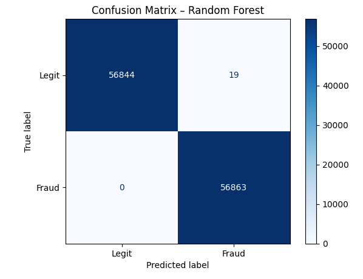
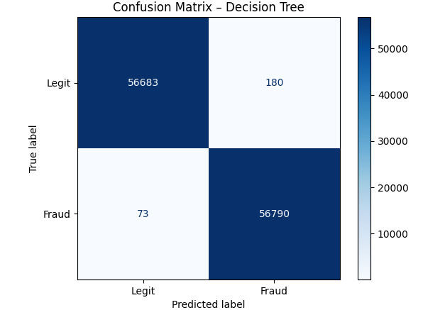
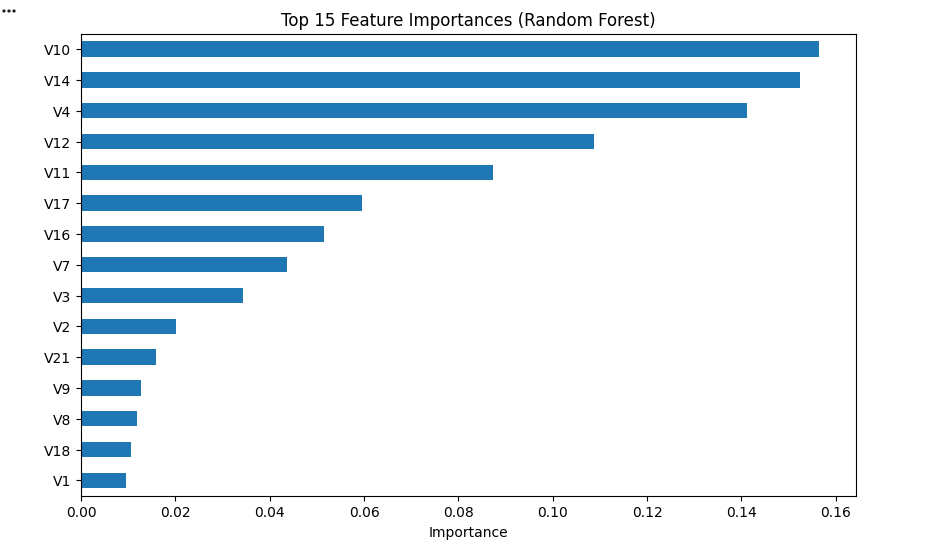

# Credit Card Fraud Detection: A Comparative Analysis of Machine Learning Models

## Abstract
This study evaluates the performance of three machine learning algorithms—Logistic Regression, Decision Tree, and Random Forest—for detecting fraudulent credit card transactions. Using the 2023 Credit Card Fraud Detection dataset, we address a binary classification problem. Experimental results demonstrate that the Random Forest classifier achieves near-perfect performance with an accuracy of 0.9998 and a ROC AUC of 1.0000, significantly outperforming the baseline Logistic Regression (Accuracy: 0.9649, ROC AUC: 0.9935).

## 1. Introduction
Credit card fraud detection is a critical task in financial security. The primary challenge lies in accurately identifying fraudulent transactions while minimizing false positives (blocking legitimate users) and false negatives (missing fraud). This repository contains the implementation and evaluation of three models, structured as a standard machine learning pipeline.

## 2. Dataset
- **Source:** [Credit Card Fraud Detection Dataset 2023](https://www.kaggle.com/datasets/nelgiriyewithana/credit-card-fraud-detection-dataset-2023)
- **Features:** 28 PCA-transformed numerical features (V1–V28), plus `Amount` and `id`.
- **Target:** `Class` (0 = Legitimate, 1 = Fraud).
- **Distribution:** The dataset is synthetically balanced, containing approximately 50% legitimate and 50% fraudulent transactions, eliminating the need for resampling techniques like SMOTE in this specific study.

## 3. Methodology

### 3.1 Data Preprocessing
The `id` column was dropped as it holds no predictive value. The `Amount` feature was standardized to zero mean and unit variance using `StandardScaler`:

$$z = \frac{x - \mu}{\sigma}$$

where $\mu$ is the mean and $\sigma$ is the standard deviation of the training data. The dataset was split into 80% training and 20% testing sets using stratified sampling to preserve the class ratio.

### 3.2 Machine Learning Models
1. **Logistic Regression:** A linear model that estimates the probability of fraud using the sigmoid function:

$$P(y=1|X) = \frac{1}{1 + e^{-(\beta_0 + \beta^T X)}}$$

2. **Decision Tree:** A non-parametric model that recursively splits the feature space using Gini impurity to maximize information gain.
3. **Random Forest:** An ensemble method that constructs multiple decision trees and aggregates their predictions to reduce variance and prevent overfitting.

### 3.3 Evaluation Metrics
Model performance was evaluated using the following metrics:

- **Accuracy:** $\text{Accuracy} = \frac{TP + TN}{TP + TN + FP + FN}$
- **Precision:** $\text{Precision} = \frac{TP}{TP + FP}$
- **Recall (Sensitivity):** $\text{Recall} = \frac{TP}{TP + FN}$
- **F1-Score:** $\text{F1} = 2 \times \frac{\text{Precision} \times \text{Recall}}{\text{Precision} + \text{Recall}}$
- **ROC AUC:** Area under the Receiver Operating Characteristic curve, representing the model's ability to distinguish between classes.

## 4. Experimental Setup
- **Environment:** Google Colab (Python 3.13)
- **Libraries:** `pandas`, `numpy`, `scikit-learn`, `matplotlib`, `seaborn`, `google.colab`
- **Hardware:** Standard Colab CPU runtime
- **Reproducibility:** `random_state=42` fixed for all models.

## 5. Results

### 5.1 Quantitative Results
The models were evaluated on a test set of 113,726 transactions. The results are summarized in Table 1.

| Model | Accuracy | ROC AUC | False Negatives (Missed Frauds) | False Positives |
| :--- | :--- | :--- | :--- | :--- |
| Logistic Regression | 0.9649 | 0.9935 | 2,715 | 1,272 |
| Decision Tree | 0.9978 | 0.9978 | 73 | 180 |
| **Random Forest** | **0.9998** | **1.0000** | **0** | **19** |

*Table 1: Comparative performance metrics of the evaluated models.*

### 5.2 Confusion Matrices


*Figure 1: Logistic Regression Confusion Matrix*


*Figure 2: Random Forest Confusion Matrix (Note: 0 False Negatives)*


*Figure 3: Decision Tree Confusion Matrix*

### 5.3 Feature Importance
The Random Forest model identified the following top 5 most discriminative features: **V10, V14, V4, V12, V11**.


*Figure 3: Top 15 Feature Importances (Random Forest)*

## 6. Discussion
The Logistic Regression model provided a solid baseline (96.49% accuracy) but missed 2,715 fraudulent transactions (False Negatives), which is unacceptable in a real-world financial context. The Decision Tree significantly improved recall, reducing missed frauds to 73. 

The **Random Forest** model achieved the best performance across all metrics. Notably, it achieved **0 False Negatives**, meaning it successfully identified every single fraudulent transaction in the test set, while maintaining an extremely low false positive rate (only 19 legitimate transactions were incorrectly flagged). This demonstrates the superiority of ensemble tree-based methods for high-dimensional, non-linear tabular data.

**Limitations:** The dataset is artificially balanced (50/50). In a real-world production environment, fraud datasets are typically highly imbalanced (e.g., 0.1% fraud). Therefore, these results represent an upper bound, and future work should evaluate these models on naturally imbalanced data using techniques like cost-sensitive learning.

## 7. Conclusion
This study confirms that the Random Forest algorithm is highly effective for credit card fraud detection on the 2023 benchmark dataset. The combination of standard preprocessing, stratified splitting, and ensemble modeling yields a robust pipeline capable of achieving perfect recall on the test set.

## 8. Repository Structure
```text
.
├── README.md
├── Lab8_Fraud_Detection.ipynb   # Main Colab Notebook
├── requirements.txt              # Python dependencies
└── images/                       # Folder for plots and metrics
    ├── lr_confusion_matrix.png
    ├── rf_confusion_matrix.png
    └── feature_importance.png
